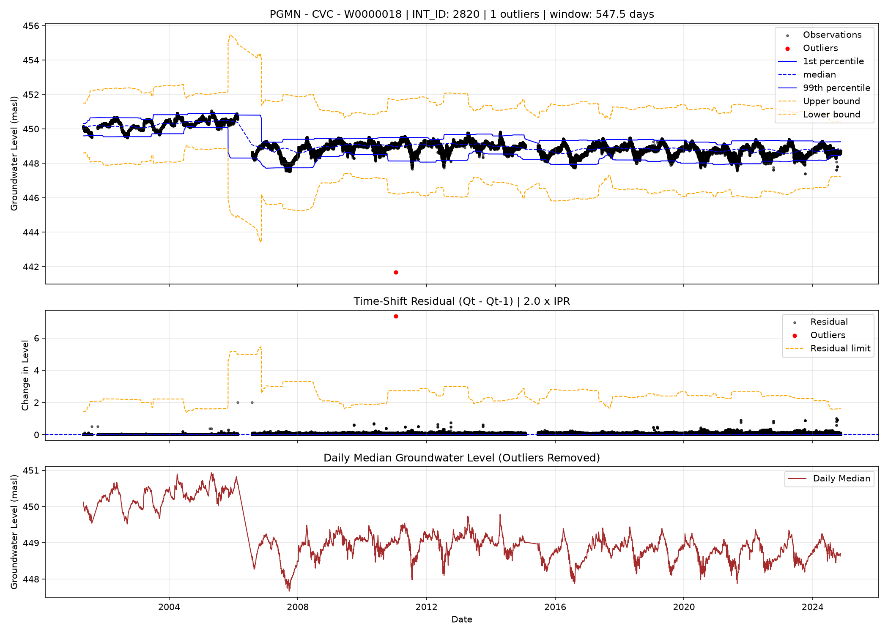
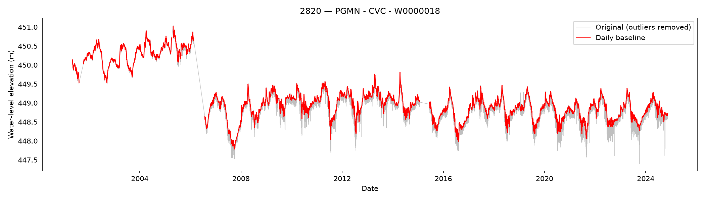

# Automatic Outlier Detection

## Overview

This procedure identifies anomalous groundwater level observations using a combination of local temporal differences, rolling statistical thresholds, and absolute value constraints. The method is designed for automated quality control of groundwater monitoring time series, including datasets containing irregular observation intervals and long-term changes in groundwater levels.

Outliers are identified through four sequential steps:

1. Detection of unusually large changes between neighbouring observations.
2. Identification of isolated observations surrounded by flagged outliers.
3. Removal of outlier flags for observations within an acceptable statistical range.
4. Application of an absolute minimum groundwater level threshold.

## Temporal Residual Calculation

A temporal residual is calculated for each observation as the maximum absolute difference between its groundwater level and those of its immediate preceding and following observations.

$$ R_t = \max\left(|h_t-h_{i-1}|,\ |h_t-h_{i+1}|\right) $$

Where:

- $R_t$ = temporal residual at observation $t$
- $h_t$ = groundwater level at observation $t$
- $h_{t-1}$ = preceding groundwater level
- $h_{t+1}$ = following groundwater level

This residual emphasizes abrupt changes in groundwater levels relative to neighbouring observations.

## Rolling Statistical Characterization

A centred moving window of **1.5 years** is applied to characterize the local distribution of groundwater levels.

The following statistics are calculated:

| Statistic              | Description                                     |
| ---------------------- | ----------------------------------------------- |
| 1st percentile         | Local lower percentile                          |
| Median                 | Local median groundwater level                  |
| Mean                   | Local average groundwater level                 |
| 99th percentile        | Local upper percentile                          |
| Inter-percentile range | Difference between the 99th and 1st percentiles |

The inter-percentile range is defined as:

$$ \text{IPR}_t=P_{99,t}-P_{1,t} $$

The moving window requires at least three valid observations. Using a time-based rolling window accommodates irregular observation intervals while allowing the statistical thresholds to adapt to changes in groundwater levels.

## Outlier Detection

### Parameters

First let $k=2.0$ is the user-defined sensitivity parameter `RANGE_MULT`, and $h_\text{min}=50.0$ be the minimum expected waterlevel in metres above seal level (masl).

### Step 1: Temporal Residual Threshold

An observation is initially flagged when its temporal residual exceeds a specified multiple of the local inter-percentile range.

$$ R_t>k\cdot IPR_t $$

This criterion identifies abrupt changes that are unusually large relative to the local variability of the hydrograph.

### Step 2: Neighbour-Based Detection

An observation is additionally flagged if both its immediately preceding and following observations have been identified as outliers. This condition identifies isolated observations located between two flagged observations, reducing fragmentation in sequences of anomalous measurements. The procedure is applied once and does not iteratively propagate flags through longer sequences.

### Step 3: Statistical Range Filtering

Upper and lower acceptance bounds are calculated using the rolling mean and inter-percentile range:

$$ \text{Upper}_t=\overline{V}_t+k\cdot \text{IPR}_t $$

$$ \text{Lower}_t=\overline{V}_t-k\cdot \text{IPR}_t $$

Previously flagged observations are retained as outliers only when:

$$ V_t<\text{Lower}_t \quad \text{or} \quad V_t>\text{Upper}_t $$

Observations within these bounds have their outlier flags removed. This additional condition reduces false positives associated with legitimate groundwater fluctuations, including abrupt changes from a previous outlier that returns to within the locally acceptable range.

### Step 4: Absolute Minimum Threshold

A final absolute threshold is applied to identify groundwater levels below a predefined minimum:

$$ V_t<h_\text{min} $$

Any observation satisfying this condition is classified as an outlier, regardless of the preceding detection criteria.

## Methodological Considerations

The following limitations should be considered:

- Irregular sampling: Temporal residuals compare adjacent records without accounting for elapsed time. Large changes across substantial monitoring gaps may therefore be incorrectly identified as anomalies.
- Window boundaries: Centred rolling windows have less temporal coverage near the beginning and end of each hydrograph.
- Sensitivity to extreme observations: The rolling mean and 99th percentile are calculated from unfiltered observations, meaning extreme values can influence the detection thresholds.
- Conservative filtering: An observation must satisfy both the temporal residual criterion (or neighbour criterion) and the statistical range criterion to remain flagged, unless it falls below $h_\text{min}$.
- Rapid natural fluctuations: Legitimate short-duration groundwater responses or pumping-related changes may be flagged if their magnitudes exceed the statistical thresholds.

## Intended Application

The procedure provides an automated first-stage screening method for large collections of groundwater hydrographs. Its primary purpose is to identify potentially erroneous observations before temporal aggregation, statistical analysis, and hydrograph decomposition. Following outlier detection, valid observations can be aggregated to daily median groundwater levels to reduce short-term variability while preserving longer-term groundwater trends.

> Important distinction: This method identifies statistical anomalies, not necessarily measurement errors. In particular, rapid changes associated with pumping may represent genuine groundwater responses rather than invalid observations.

## Parameter Selection and Manual Tuning
The parameters governing outlier detection, including the rolling window duration (1.5 years), residual threshold multiplier $(k)$, and absolute minimum groundwater level $(h_\text{min})$, were selected through manual tuning. Parameter values were iteratively adjusted based on visual inspection of representative groundwater hydrographs to balance the detection of anomalous observations against the preservation of legitimate groundwater fluctuations. Consequently, the selected parameters are empirically determined rather than statistically optimized, and their performance may vary across monitoring locations with different hydrogeological characteristics and temporal variability.

 
 

# Groundwater Hydrograph Preprocessing: Daily Quantile Series

## Purpose

Groundwater-level time series originate from irregular or sub-daily observations. Here, a process is described on how these data were aggregated into daily summaries. It removes observations previously flagged as outliers and computes a configurable daily quantile as a candidate representative groundwater level. Days without sufficient observations remain missing rather than being interpolated.

## Daily aggregation

Resample the time-series to calendar days and calculate arithmetic mean, median, minimum and maximum. The daily aggregation is then defined as the empirical `BASELINE_QUANTILE` of that day's observations, only if there are more than 6 measurements provided in a daily sample. 

The `BASELINE_QUANTILE` is used to generate the daily representative value, between 0 and 1. For example, `0.5` gives the median and `0.9` gives the 90th percentile (currently the `BASELINE_QUANTILE` is set to the 90th percentile). Its interpretation depends on whether the measured variable is groundwater elevation or depth to water and on the direction of pumping-related excursions.

## Interpretation and limitations

The quantile is a **candidate daily baseline**, not an independently estimated natural (unpumped) groundwater level. For groundwater elevations where pumping causes drawdown (lower measured levels), an upper daily quantile may reduce the influence of intermittent pumping, **provided sufficient recovery is observed during that day**. Persistent pumping, incomplete recovery, sparse sampling, or uneven observation times can bias the estimate.

