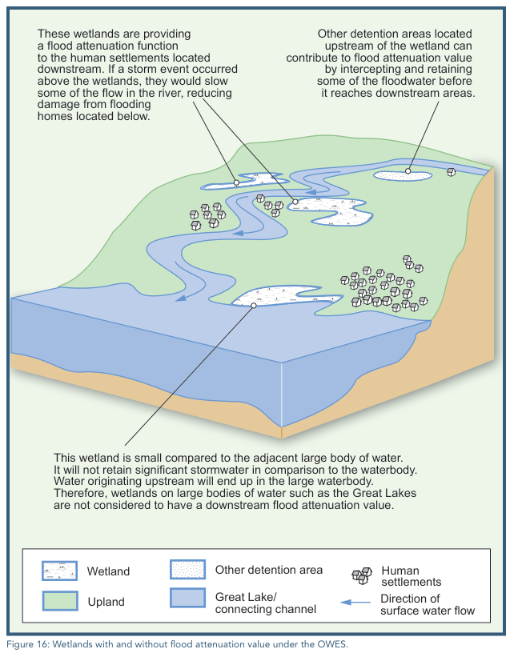
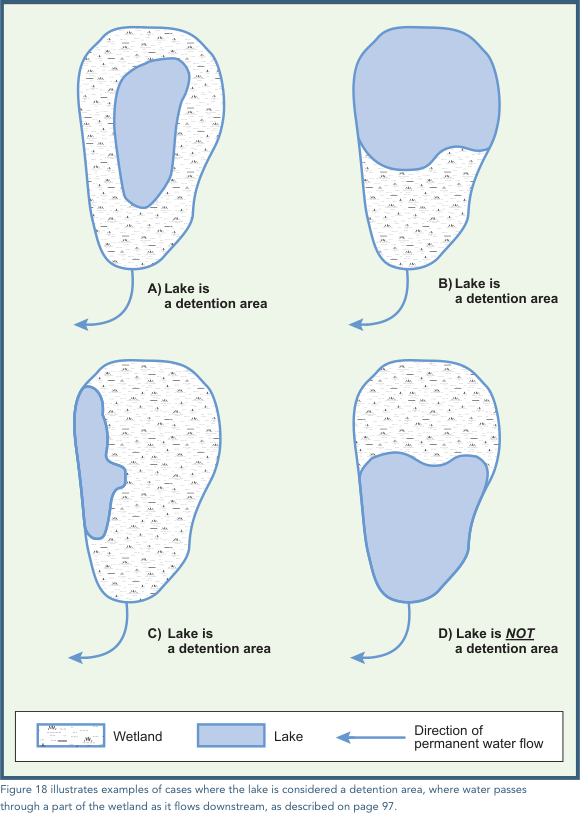
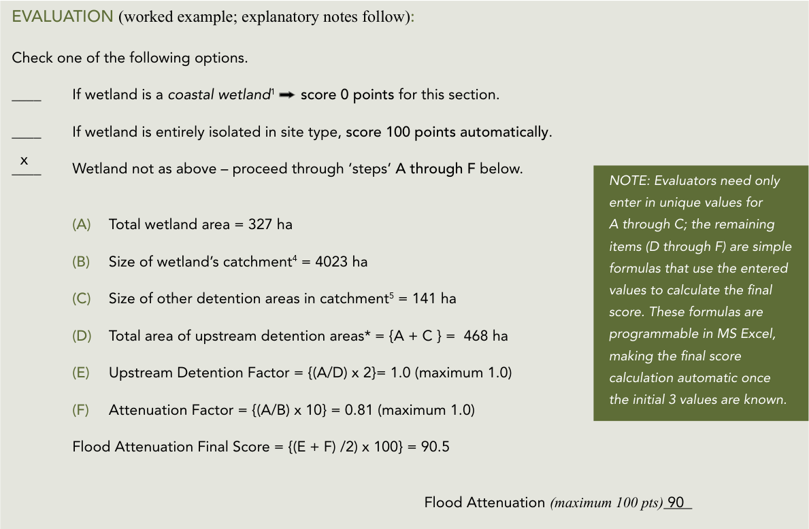

## Automated Catchment Delineation and Watershed Characterization

### Purpose and Overview

The **ORMGP Wetland Hydrologic Screening Tool** provides an automated means of delineating surface-water catchments and characterizing their hydrological properties across the Oak Ridges Moraine Groundwater Program (ORMGP) study area.

Built using **R Shiny and Leaflet**, the application combines automated drainage-area delineation with spatial analysis of regional environmental datasets. By selecting a mapped wetland, users can identify its contributing catchment, characterize the surrounding landscape and obtain watershed-scale estimates of hydrological conditions.

The application brings together three principal capabilities:

1. **Automated catchment delineation:** Identification of the surface drainage area contributing to a selected wetland.
2. **Watershed characterization:** Aggregation of topographic, land-use and surficial-geology properties across the delineated catchment.
3. **Water-budget estimation:** Summarization of spatially distributed water-budget estimates at the watershed scale.

These capabilities provide a consistent and reproducible means of examining catchment characteristics without requiring users to undertake extensive GIS processing.

> The resulting information can support preliminary hydrological investigations, regional comparisons and the prioritization of locations requiring more detailed assessment.

### Interactive Mapping Tool

*Full-screen mode is available in the top-left corner.*

<iframe src="https://owrc.shinyapps.io/owes/" width="100%" height="600" scrolling="no" allowfullscreen></iframe>

### Automated Catchment Delineation

A central capability of the tool is the automatic identification of contributing drainage areas.

The application uses the ORMGP's regional **Hydrologically Corrected Digital Elevation Model (HDEM)** to establish surface drainage directions and connectivity.

The HDEM was developed from the Ontario Ministry of Natural Resources and Forestry's Provincial Digital Elevation Model. Hydrological processing includes depression filling, the correction of flow directions across flat terrain and D8 flow-routing calculations. Manual flow-path corrections have also been incorporated where automated processing does not adequately represent known drainage pathways.

These procedures establish a continuous drainage topology that allows contributing catchments to be delineated automatically.

For wetlands, the original point-based catchment delineation methodology has been extended so that selecting a location within a mapped wetland identifies the **catchment contributing to the wetland as a whole**, rather than simply the area draining to the selected point.

This provides a consistent spatial boundary within which additional environmental and hydrological properties can be calculated.

The underlying terrain-processing and drainage-area delineation methodology is described in:

[ORMGP — Overland Drainage Pathways](https://owrc.github.io/interpolants/interpolation/overland.html)

### Raster-Based Watershed Characterization

Once a catchment has been delineated, the application characterizes the watershed using regional raster datasets.

The delineated catchment is used as the spatial boundary for aggregating topographic, land-use and surficial-geology information, allowing the landscape to be described using a consistent set of watershed-scale characteristics.

The principal datasets include:

| Raster Dataset | Source | Watershed Characterization |
|---|---|---|
| Digital Elevation Model | MNRF / ORMGP | Terrain elevation, slope, aspect and drainage characteristics. |
| Land Use | Southern Ontario Land Resource Information System (SOLRIS) | Distribution of land-use categories and associated properties, including impervious surfaces, vegetation, wetlands and open water. |
| Surficial Geology | Ontario Geological Survey (OGS) | Distribution of surficial geological materials and their associated relative permeability characteristics. |
| Depth to Watertable | ORMGP | Distribution of the interpolated watertable [WT1](https://owrc.github.io/watertable/). |

Raster values are summarized within the delineated catchment to produce watershed-scale statistics.

For continuous datasets, these summaries may include representative values such as mean elevation or slope. For categorical datasets, the relative coverage of different land-use or geological classes provides a description of the watershed's composition.

This approach allows watersheds to be compared using their physical characteristics, including topographic relief, land cover, imperviousness and the relative permeability of surficial materials.

These characteristics provide useful context for interpreting watershed hydrology, particularly the processes influencing infiltration, surface runoff and groundwater recharge.

Further documentation:

- [ORMGP Sub-watershed Characterization](https://owrc.github.io/interpolants/interpolation/subwatershed.html)
- [Land Use Characterization](https://owrc.github.io/interpolants/interpolation/landuse.html)
- [Surficial Geology](https://owrc.github.io/interpolants/interpolation/surfgeo.html)

### Watershed Water-Budget Estimates

In addition to its physical characteristics, the tool provides estimates of watershed-scale hydrological conditions using the ORMGP's regional water-budget information.

The ORMGP maintains a spatially distributed hydrological model that estimates the movement and partitioning of water across the landscape. Model outputs include estimates of precipitation, evapotranspiration, surface runoff and groundwater recharge.

By aggregating spatially distributed water-budget estimates over the delineated catchment, the application provides a watershed-scale representation of these hydrological quantities.

This allows the estimated water budget to be considered alongside the watershed's topography, land use and surficial geology.

Importantly, these are **model-derived regional estimates**, rather than direct measurements of watershed water balance. Their reliability depends on the underlying hydrological model, input datasets and spatial resolution.

The water-budget estimates are intended to provide regional hydrological context and should not be interpreted as a substitute for a calibrated, site-specific hydrological assessment.

Additional information on the underlying model is available here:

[ORMGP — Regional Water Budget Model](https://owrc.github.io/interpolants/modelling/ravenmodel.html)

### Wetland Mapping

The application uses a consolidated regional inventory of mapped wetlands.

The primary wetland mapping originates from the **Ontario Ministry of Natural Resources and Forestry (MNRF)**.

Additional wetland mapping was provided by:

- **Credit Valley Conservation (CVC)**
- **Nottawasaga Valley Conservation Authority (NVCA)**

Within their respective coverage areas, the wetland layers supplied by CVC and NVCA were used to **replace the corresponding provincial wetland mapping**.

This approach incorporates locally maintained mapping where available while retaining provincial coverage throughout the remainder of the study area.

The screening application includes approximately **126,700 mapped wetland features**.

### Additional Analysis: OWES Flood Attenuation

One application of the automated catchment delineation and watershed characterization is the calculation of the flood-attenuation component of the [Ontario Wetland Evaluation System (OWES)](https://www.ontario.ca/files/2023-02/mnrf-pd-rpdpb-ontario-wetlands-evaluation-system-southern-manual-2022-en-2023-02-02.pdf).

Under OWES, flood attenuation is evaluated using three principal spatial characteristics:

1. The area of the wetland being evaluated.
2. The area of its contributing catchment.
3. The area of other detention features within that catchment.

The evaluation also considers connectivity or proximity to major waterbodies.

The application automatically determines these spatial characteristics and applies the relevant OWES calculations to derive the **Upstream Detention Factor** and **Wetland Attenuation Factor**.

Other detention features may include wetlands, lakes, reservoirs, ponds and other mapped waterbodies within the contributing catchment.

This functionality demonstrates how the underlying catchment analysis can be extended to automate an established environmental assessment procedure.

#### Treatment of Wetland Groups

An important consideration in applying the OWES methodology is determining what constitutes an individual wetland.

OWES recognizes that closely grouped wetlands may function together as a single wetland unit, including situations where wetland areas are separated by roads, railways or narrow upland features.

For purposes of the screening tool, however, **mapped wetland polygons are evaluated independently**, rather than being automatically grouped into larger wetland complexes.

Where a road, railway or other mapped feature separates two wetland polygons, each is assessed according to its mapped geometry.

This provides a consistent and reproducible screening approach but does not establish that the features are hydrologically independent.

During a formal OWES evaluation, a qualified evaluator may determine that several mapped polygons should be considered together. Such an interpretation may alter the calculated wetland area, contributing catchment and associated flood-attenuation score.

### Technical Limitations

#### Spatial Resolution

The regional HDEM has a spatial resolution of **60 m × 60 m**, equivalent to 0.36 hectares per grid cell.

Although suitable for regional-scale drainage analysis, this resolution introduces uncertainty when delineating smaller watersheds.

Particular caution is warranted for:

- Small wetlands and catchments comprising relatively few DEM cells.
- Narrow drainage pathways and headwater catchments.
- Flat terrain where small elevation differences influence drainage direction.
- Areas where roads, culverts, drainage ditches or other infrastructure influence surface drainage.

These features may not be adequately represented in the regional elevation model, potentially affecting the calculated catchment boundaries and associated watershed statistics.

**Results for small watersheds should therefore be interpreted with particular caution.** Where greater accuracy is required, catchment boundaries should be verified using higher-resolution elevation data, local drainage information or field observations.

#### Source Data and Model Uncertainty

Watershed characterization depends on the accuracy and resolution of the underlying raster datasets.

Land-use and surficial-geology classifications represent regional interpretations and may not capture local variability or recent changes in landscape conditions.

Similarly, aggregated water-budget estimates inherit uncertainties associated with the regional hydrological model and its input data.

The application provides a systematic basis for regional screening but does not replace detailed field investigations, local hydrological modelling or professional interpretation.

### Intended Use — Screening Purposes Only

> **Screening Tool:** A preliminary, systematic decision-support method used to identify and prioritize locations where further investigation may be warranted. Its purpose is to guide the efficient allocation of limited resources, not to provide definitive technical conclusions.

The ORMGP Wetland Hydrologic Screening Tool is intended to support preliminary watershed investigations, regional comparisons and the prioritization of locations for further study.

By combining automated catchment delineation, raster-based watershed characterization and regional water-budget estimates, the tool provides rapid access to hydrological information that would otherwise require substantial GIS processing.

Additional analyses, including the OWES flood-attenuation calculation, demonstrate how these underlying datasets and procedures can be applied to specific environmental assessment questions.

**The results should not be interpreted as definitive technical conclusions or used independently for regulatory determinations.**

Where the results inform planning, management or regulatory decisions, they should be considered alongside higher-resolution datasets, local hydrological knowledge, field observations and appropriate professional judgement.

### OWES Reference Figures

Ontario Ministry of Natural Resources and Forestry (MNRF). 2022. *Ontario Wetland Evaluation System: Southern Manual*. Fourth Edition. King's Printer for Ontario, Peterborough, Ontario.

[OWES Southern Manual — Fourth Edition](https://www.ontario.ca/files/2023-02/mnrf-pd-rpdpb-ontario-wetlands-evaluation-system-southern-manual-2022-en-2023-02-02.pdf)

